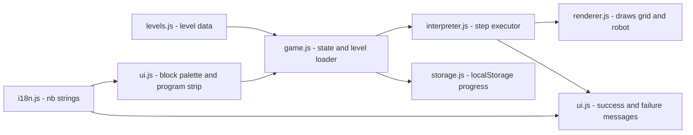

# Robotspillet – Project Plan

A browser game that teaches two Norwegian kids (6 and 9) what programming is.
The child builds a program out of command blocks, presses **Kjør**, and watches a
robot try to reach the goal on a grid. Hosted free on GitHub Pages.

Project root: `C:\Users\totli\Documents\Spill\robotspillet`
GitHub repo: `robotspillet` (public)
Live URL after deploy: `https://<username>.github.io/robotspillet/`

## Goals

| # | Goal |
|---|------|
| 1 | Teach **sequencing** (commands run in order), **loops** (Gjenta), and **debugging** (watch it fail, fix it, retry). |
| 2 | Playable by a 6-year-old early reader: every block has an icon, big tap targets, no required reading. |
| 3 | Engaging for a 9-year-old: text labels, harder levels, loops, later functions and conditions. |
| 4 | Norwegian (bokmål) UI. Strings kept in one i18n map so English can be added later. |
| 5 | Works on tablet (touch) and laptop (mouse/keyboard). |
| 6 | Zero build tooling: plain HTML/CSS/JS, deployed straight from the GitHub repo. |

## Key design decisions

- **Vanilla HTML/CSS/JS with ES modules.** No npm, no bundler. GitHub Pages serves the files as-is.
- **Tap-to-add first, drag-to-reorder second.** HTML5 drag-and-drop is unreliable on touch screens.
  Tapping a palette block appends it to the program; tapping a program block removes it.
  Reordering via Pointer Events is a later enhancement, not a blocker.
- **Levels are data, not code.** Each level is a JSON object: grid size, walls, start position/direction,
  goal, available blocks, optional max-block-count (forces loop use). Adding levels never touches logic.
- **Step-by-step interpreter.** The program runs one command at a time with a visible delay
  and the current block highlighted, so the child sees cause and effect.
- **Two difficulty tiers.** A world selector: "Lett" (6-year-old: short sequences) and
  "Vanskelig" (9-year-old: loops, tight block limits). Progress stored in `localStorage`, per player name.
- **GitHub Pages from `main` branch root.** Simplest possible deploy; every push is live within a minute.

## Block vocabulary

| Block | Icon | Norwegian label | Tier |
|-------|------|-----------------|------|
| Move forward | ⬆️ | Gå fram | Lett |
| Turn left | ↪️ | Snu venstre | Lett |
| Turn right | ↩️ | Snu høyre | Lett |
| Repeat N times | 🔁 | Gjenta × N | Vanskelig |
| Repeat until goal | 🔁🏁 | Gjenta til mål | Vanskelig (stretch) |
| If wall ahead | 🧱❓ | Hvis vegg foran | Vanskelig (stretch) |

## Architecture



## File layout

```
robotspillet/
├── index.html              # single page, loads js/main.js as module
├── css/
│   └── style.css           # big touch targets, responsive grid, animations
├── js/
│   ├── main.js             # bootstraps game, wires UI events
│   ├── game.js             # game state, level selection, win/lose rules
│   ├── levels.js           # array of level definitions (two worlds)
│   ├── interpreter.js      # turns block list into steps, runs with delay
│   ├── renderer.js         # draws grid, walls, goal, robot (DOM-based)
│   ├── ui.js               # palette, program strip, buttons, modals
│   ├── storage.js          # save/load progress per player
│   └── i18n.js             # nb (default) string table
├── assets/
│   ├── robot.svg, goal.svg, wall.svg
│   └── sounds/ (optional: step, bump, win)
├── plans/
│   └── robotspillet-plan.md # this file
├── README.md               # how to play, how to add a level, how it is deployed
├── LICENSE                 # MIT
└── .gitignore
```

## Level progression (initial set)

**Verden 1 – Lett (6 år)**
1. Straight line, 2 steps forward.
2. Straight line, 4 steps forward.
3. One turn: forward, turn right, forward.
4. Two turns.
5. A wall in the way – must go around (introduces debugging).

**Verden 2 – Vanskelig (9 år)**
1. Same as 1.2 but max 2 blocks → forces `Gjenta ×4 [Gå fram]`.
2. Square path with `Gjenta ×4 [Gå fram, Snu høyre]`.
3. Staircase pattern with nested repeat.
4. Maze with a block limit.
5. Long corridor with `Gjenta til mål` (stretch).

## GitHub setup

1. Create a public repo `robotspillet` under your GitHub account.
2. `git init` in `C:\Users\totli\Documents\Spill\robotspillet`, commit, push to `main`.
3. GitHub → Settings → Pages → Source: *Deploy from a branch* → `main` / `/ (root)`.
4. Game URL: `https://<username>.github.io/robotspillet/`.
5. No GitHub Actions workflow needed for static files.

## Out of scope for v1

- Accounts, backend, multiplayer.
- Level editor UI (levels are edited in `levels.js`).
- Blockly/Scratch integration – intentionally hand-rolled so the code stays small and readable.

## Cleanup note

An earlier draft of this plan was written to `C:\Users\totli\Documents\Spill\robot-koder\plans\`.
That folder is obsolete and can be deleted.
